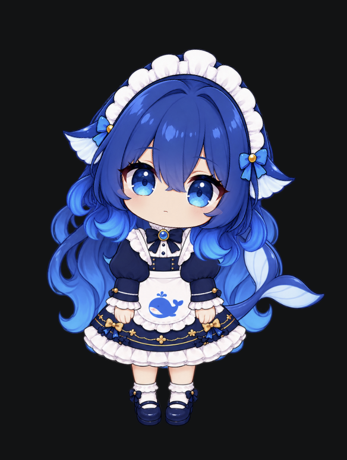
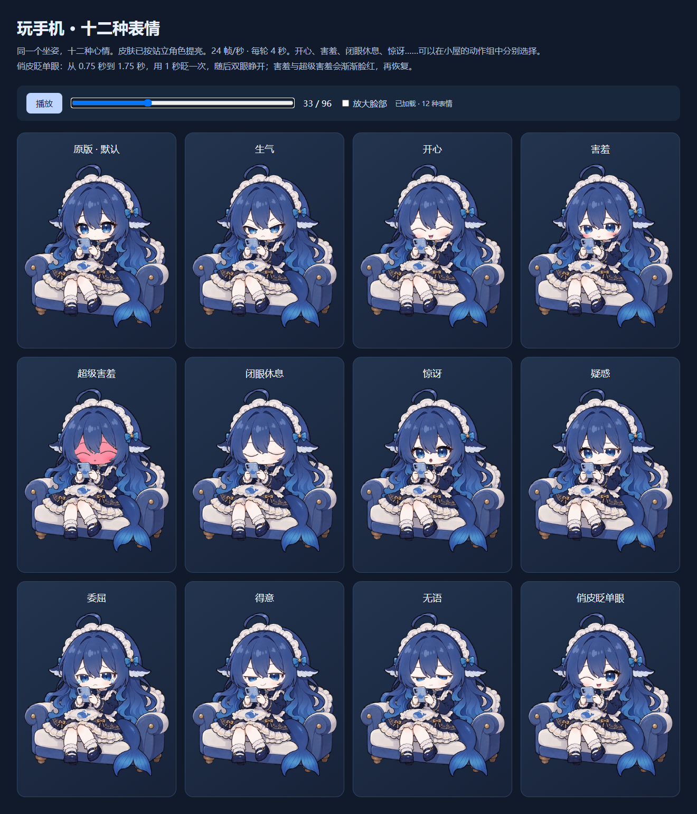
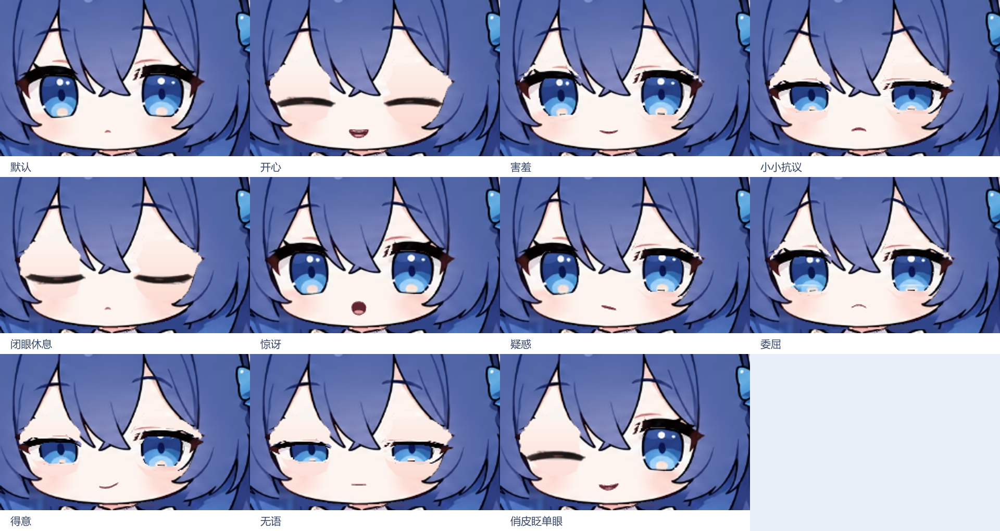

# DeepBlue · 小蓝桌宠

一个可离线运行的 Windows 桌宠。Electron + React 管理窗口与小屋，Live2D Cubism Core 驱动原图拆件模型，PixiJS 8 负责桌面合成与特效。动作、动作组和图片序列均由本地 JSON 定义。

## 效果预览


<details><summary>早期角色效果图</summary>



</details>

## 直接使用

推荐分享 `release/DeepBlue-Setup-1.3.12-win-x64.exe`：安装向导会安装到用户程序目录，并创建桌面与开始菜单快捷方式。安装后移动或删除源码文件夹不会影响使用。

免安装使用 `release/DeepBlue-Desktop-Pet-1.3.12-win-x64.exe`：单个文件包含运行环境、Live2D 运行库和全部素材，无需 Node.js、账号或网络。把它保留在固定位置，首次启动会自动解压。便携 EXE 本身被移动后，手工指向它的快捷方式仍需更新。

两个 EXE 均未签名；若系统策略拒绝运行，请勿关闭安全策略。实际验证结果见 docs/TEST_REPORT.md。

- 单击头部：摸摸头；单击身体：戳戳肚子。设置里可以更换绑定动作。
- 移动鼠标：眼神随鼠标上下左右移动；空闲时自动眨眼、呼吸、摆尾与摆动发梢。
- 双击角色：打开“桌宠小屋”；右键角色：打开菜单。
- 按住并移动超过 6 DIP：拖动；松手会站稳，拖动不会误触单击。
- 正常情况下，人物区域可交互，透明空白区域近似穿透。
- 开启全部穿透后，从托盘选择“恢复交互”，或按 `Ctrl + Alt + P`。
- 托盘提供显示、隐藏、重置位置、恢复交互和退出。关闭小屋不退出桌宠。
- 固定位置会禁止拖动和所有移动动作。关闭漫游只影响自动散步。

内置 32 组动作：微风摇摇、看看四周、向你招手、开心跳跳、有点害羞、小小抗议、盖被子睡觉、向左散步、向右散步、摸摸头、戳戳肚子、站稳啦、水光变奏、歪头疑惑、有点委屈、小小得意、有点无语、俏皮眨单眼、超级害羞、提裙摇摇，以及十二种玩手机表情。

1.3.9 补齐“玩手机”表情：原版默认、生气、开心、害羞、超级害羞、闭眼休息、惊讶、疑惑、委屈、得意、无语、俏皮眨单眼。每种都是独立动作，保留原坐姿、手机、手指与尾巴，96 帧、24fps、4 秒；新增睁眼表情会眨眼，害羞与超级害羞有脸红进入/退出过渡。超级害羞版保持握手机姿势，以满脸泛红、闭眼和微张嘴表达。打开小屋 → 动作组，搜索“玩手机”即可逐项预览或绑定点击；十种新版本默认不参与随机，可单独开启。



1.3.12 将十二种玩手机动画的肤色校准至站立角色：面部、双手与腿部统一提亮，闭眼皮肤与表情图集同步处理，保留害羞时的脸红变化和原有阴影。

1.3.11 将玩手机的单次眨眼延长至 **1 秒**：0.75 秒开始合眼，1.75 秒恢复双眼睁开；保留平滑闭合、短暂停留和睁开过程，每次动作只眨一次，总长仍为 4 秒。

1.3.10 将“玩手机俏皮眨单眼”改为一次短促眨眼：约 0.75 秒开始，1.125 秒恢复双眼睁开；其他时间保持睁眼微笑，总动作仍为 4 秒。

1.3.0 新增疑惑、委屈、得意、无语和眨单眼，共 11 种表情（含默认与闭眼休息），同时完善开心、害羞、抗议和惊讶的嘴型。眼皮、原眉毛、嘴型及泪光一起随头运动。打开小屋 → 动作组即可逐个预览，也能在设置中选作摸头或身体点击回应。疑惑、得意、眨单眼默认参与随机待机；委屈和无语默认只手动触发，可自行开启随机。

1.3.1 加深害羞时的双颊腮红，扩大晕染范围并柔化边缘；表情预览现在使用完整桌宠渲染，包含腮红。

1.3.7 将“玩手机”恢复到视频原生 24fps：96 个连续原帧，时长仍为 4 秒，画布、清晰度与配色保持一致。透明 GIF 同步更新；小屋 → 动作组 → 玩手机可直接预览。

1.3.8 新增独立的“玩手机生气”：皱眉、微眯眼、撇嘴，保留原坐姿和 24fps 动画；原来的“玩手机”仍可使用。新动作默认不参加随机，在小屋 → 动作组 → 玩手机生气中预览，也可单独开启随机或绑定点击。

1.3.6 新增“玩手机”：从用户视频直接抠出角色与沙发，使用连续 60 帧、15fps、4 秒的透明动画，保留原始配色和坐姿。小屋 → 动作组 → 玩手机可预览，也可绑定点击；默认低频随机播放，仅从站立进入，结束、停止、拖动或重载后恢复。审计标记 `_tag` 的历史图片不再参与纹理加载和 EXE 打包。

1.3.5 修正眨眼及闭眼表情的眼周肤色：重建与周围皮肤衔接的底层渐变，替换双眼皮移开后单色三角补片的 UV，保留原腮红和眼睑动作。开心、闭眼休息、单眼笑、半闭眼及超级害羞共用修复后的模型。

1.3.4 将“提裙摇摇”的肤色、蓝发和白色衣料提亮至接近站立角色；27 帧使用一致的色彩曲线，保持原轮廓、透明边缘和动作节奏。

1.3.3 新增“提裙摇摇”：沿用户 GIF 的原帧修复线条、描摹透明轮廓，保留原肤色和灰蓝发色，导出 27 张 720×960 透明 PNG。每帧 100ms，总长 2.7 秒，播放一次后回到站立。去掉房间、地板和地面阴影，保留原画面的位置与摇摆。打开小屋 → 动作组 → 提裙摇摇即可预览，也能设置为点击回应；默认以低权重参与随机待机。原素材为 240×320，细节修复不等于获得无损的原始高清画稿。

1.3.2 新增“超级害羞”：迅速抬手遮脸，脸部泛红、闭眼、嘴巴微张，头顶蒸汽缓缓上升。手掌与前臂对齐，抬手后露出的头发补有完整发束和高光。2.8 秒内完成抬手、停留和放手（抬手 260ms、放手 320ms）；放手时渐渐恢复肤色并睁眼，中止则立即恢复。共 12 种表情；在小屋 → 动作组 → 超级害羞中预览，也可设置为点击回应。



1.2.7 修正“小小抗议”：直接驱动原图眉毛的网格形变，配合半闭眼和摇头，不再叠画第二对眉毛；动作结束、取消或资源重载后恢复。

1.2.8 将双眼皮线和右眼残留睫毛归入眼睑绑定：眨眼时双眼皮随眼睑下移、淡出，睁眼后恢复，不再悬在原处。

左右散步使用三视图中的侧面造型：左走原侧面，右走镜像；双腿交替迈步，手臂与尾巴摆动。每方向 32 帧、40 FPS，800ms 一周期，重复三次与 2400ms 的桌面移动同步。完成、停止或拖动打断后恢复正面 Live2D。

盖被子睡觉只从站立待机直接进入，持续 14.4 秒后恢复站立。使用新版盖被侧卧原画，嘴巴缓慢张合，最小面积为最大时的三分之一；头、身体、枕头和被子保持稳定，独立鲸尾绕根部轻摆，Z 从头部上方向右上方飘散。每轮 24 帧、3.6 秒，循环四次。它参与随机待机（空闲至少 8 秒、鼠标远离、60 秒冷却），也可在小屋的动作组列表预览；其他动作进行时不能强制进入睡觉。取消、拖动或打断会清除睡姿和 Z。

1.2.5 将睡姿脸部肤色校准到站立角色的浅暖肤色，保留腮红、阴影和口型细节。

1.2.6 将睡姿按头部大小放大约 45%，接近站立时的头部比例。睡觉时窗口自动加宽，醒来后恢复；Z 与鼠标区域同步定位。大小设置现在同步缩放角色画面、特效和点击范围。

## 开发与构建

在项目根目录运行（支持整个项目目录移动或改名）：

```powershell
npm install
npm run dev
npm run typecheck
npm run lint
npm run test
npm run build
npm run dist:win
```

`npm run start` 运行已构建版本。`npm run test:watch` 是监听测试，普通 `test` 会自动退出。`dist:win` 会先检查类型并构建，然后生成 Windows x64 安装版和便携版。没有签名证书，不配置假签名。

本机实际验证版本：Node **24.20.0**、npm **11.19.0**、Electron **44.2.0**、PixiJS **8.20.1**、React **19.2.8**、TypeScript **5.9.3**、electron-vite **5.0.0**、Vite **7.3.6**、electron-builder **26.15.3**、Vitest **3.2.7**、Zod **4.5.4**。以 `package-lock.json` 锁定的依赖为准；复现安装可使用 `npm ci`。

本机默认 Electron 下载源连接失败，改用镜像成功安装：

```powershell
$env:ELECTRON_MIRROR='https://npmmirror.com/mirrors/electron/'
node node_modules/electron/install.js
```

这个环境变量只用于开发下载，程序运行时不访问镜像。

## 不写 TypeScript，增加一个动作

1. 打开小屋 → **动作组 → 导入动作包**。
2. 选择 `examples/custom-action-pack`（便携版解压资源中也附带此示例）。
3. 列表出现“点头后开心挥手”，点击预览即可。它同时引入一个新的点头 motion。
4. 点击“打开用户动作包目录”，修改已导入包中的 JSON 和 `pack.json` 清单，然后点击“重新加载”。无需编译。

完整教程：[动作包格式](docs/ACTION_PACKS.md)。加载失败会保留旧的可用快照。修改导入前的原文件夹不会自动修改已经复制到用户目录的包。

## 配置与存储

配置和用户动作包位于 Electron `userData`（本程序默认 `%APPDATA%\deepblue-desktop-pet`，可通过界面打开动作包子目录）。`settings.json` 保存大小、开关、位置、点击绑定和以完整组 ID 为键的覆盖项；`action-packs/` 保存导入的动作包。不会修改安装目录里的内置 JSON。损坏配置会重命名备份再恢复默认值。

## 素材与 AI 边界

桌面站立状态使用用户确认的 **三视图原画拆件 Live2D 模型**：38 个独立网格、24 个参数。眼白、虹膜、眼睑分离，眨眼使用剪裁遮罩，瞳孔不会被压扁；尾巴、头发、鱼耳独立绑定。运行文件和 Core 均位于 `src/renderer/public/live2d/`，随构建打包，无需本机制作目录。小屋预览、水光序列也使用模型的画面。

睡觉保留已确认的 AI 盖被子素材，只从站立进入，结束或取消后恢复 Live2D。现有 JSON 动作经适配器驱动新模型，部件幅度限制在正面原画可支撑的范围；已支持表情嘴型，大角度侧转和语音口型尚未制作。`npm run assets` 是旧版 AI 组件制作脚本，请勿用它覆盖当前预览和水光序列。素材来源和运行库许可见 [素材说明](docs/ASSET_SOURCES.md)。

AI 模式明确不可用：无 API Key、无模型 SDK、无聊天、无语音、无屏幕读取。类型在 `src/shared/contracts.ts`，可信命令入口在 `src/renderer/pet/PetRuntime.ts`，不可用检查在 `src/renderer/pet/behavior.ts`。详见 [未来 AI 接口](docs/FUTURE_AI.md)。

## 交付和验证

- [架构说明](docs/ARCHITECTURE.md)
- [素材来源与生成提示词](docs/ASSET_SOURCES.md)
- [实际测试报告及平台限制](docs/TEST_REPORT.md)
- [中文实现细纲](docs/实现细纲.md)

Windows 透明穿透采用系统整窗开关和有限频率鼠标采样，不承诺逐像素命中。当前优先验证 Windows 11；不宣称其他系统、多显示器热插拔等未实际执行的组合全部通过。

## 旧版本记录

1.1 的便携包曾被本机应用控制阻止，因此旧快捷方式指向源码目录。1.1.1 新增安装包，当前结果见测试报告。
