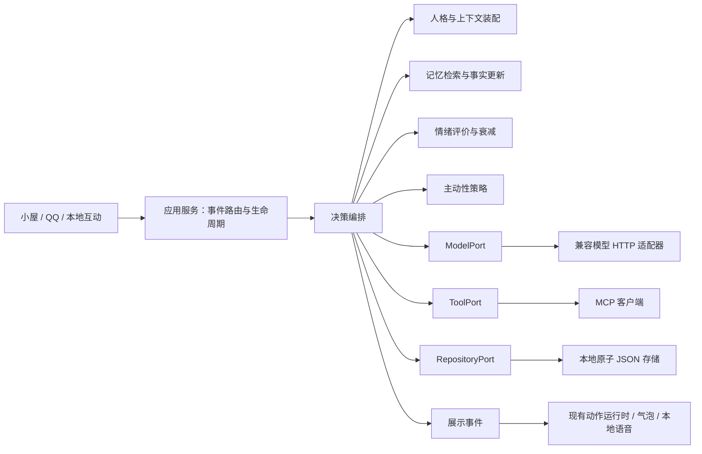

# 大肥鱼智能陪伴 · 1.4.5

## 日记

入口：**小屋 → 智能陪伴 → 日记**。每天按本机时间 **21:00 自动写作**，不需要打开这个页面。保留“写今天的日记”作为手动追加入口。

- 自动进度从1.4.5首次启动当天开始记录。21点前启动不会提前写当天；21点后启动会处理当天。漏掉多天时，下次启动从最早漏写日逐篇补上，文件仍按原日期命名，正文注明实际补记时间。不回补启用此功能之前的日期。
- 每个日期只自动生成一次。完成进度单独保存在 userData 的 `diary-schedule.json`，改保存地址或重启不会重复生成旧日期。进度中可能暂存一篇已生成、待落盘的正文，提交完成后移除；日记文件含隐藏的去重标记，异常退出后可恢复提交而不用再次请求模型。不要手动修改自动进度或去重标记。
- 未启动时不会唤醒电脑或运行后台常驻程序，下次打开再补。系统休眠时中断进行中的写作，恢复后继续检查。用户正在聊天时会等该轮完成再写；生成、磁盘或网络失败保留待办，15分钟后重试。手动停止也会暂缓15分钟，改目录后可以立即重新检查。
- 日记页面展示固定时间、待补写天数、最近完成日期和失败后的重试时间。已完成日记即使被手动删除也不会自动重建；仍可通过手动入口追加当天记录。

- 自动写作在已启用模型且有该日对话资料时复用现有模型连接，每次尝试只请求一次，以大肥鱼的口吻总结对应日期的桌面对话；无该日资料时保存如实说明，不为每个空白日额外调用模型。手动写作仍可在无对话时请求模型。提示词只包含人格、对应日期对话及当天写作时已启用的心情；补记不把当前心情当成历史心情。不传入服务地址、密钥、MCP 工具、旧记忆或 QQ 对话。
- 普通模式也能保存“本地纪事”，直接摘录最多20条对话，明确标注未使用模型。没有该日资料时说明没有找到保留下来的记录，不断言那天从未聊过。
- 保存 `大肥鱼日记-YYYY-MM-DD.md`，日期按本机时区确定；手动使用点击日期，补记使用待补日期。同日手动再次写入会追加带时间的章节；自动只提交一次。失败、取消不保存半篇目标文件，已有内容保留。模型失败会显示错误，不静默换成另一种写法。
- 源码和仓库内发布程序默认定位项目根目录。便携程序移出仓库后默认放在 EXE 同目录，安装版找不到源码时放在“文档/大肥鱼日记”，不写入 app.asar 或便携解压临时目录。
- “保存位置”支持输入完整路径、原生选择文件夹、打开目录和恢复默认；配置单独保存在 userData 的 `diary-settings.json`，重启有效。换目录只影响后续写入，不复制、搬动或删除旧日记。无写权限时显示错误，请选择可写位置。
- 窗口可查看所选目录最近90个日期的日记，文件仍全部保留。单日读写上限1MiB，超出时需在文件夹中自行整理。预览按文本显示，不执行 Markdown 中的 HTML 或外链。
- 依据的是陪伴存储**当前仍保留**的当天记录（总历史上限400条），不是完整的永久聊天档案。模型材料最多24000字符，每条最多2000字符。清空聊天或忘记记忆不会删除已导出的日记，应在保存目录另行管理。
- 项目内匹配 `大肥鱼日记-*.md` 的文件由 `.gitignore` 排除；构建白名单也不包含日记。自定义到其他 Git 仓库时，其忽略规则由该仓库管理。

实现按 `shared/diary.ts`（契约）、`companion/diary.ts`（资料与提示）、`main/diary/`（独立服务/磁盘）、`DiaryPanel.tsx`（界面）分离。只有小屋窗口能访问日记 IPC；人物和悬停窗口不能读取日记或设置其路径。写作不修改记忆或情绪，也不通过 MCP 执行操作。

这是可以配置和运行的第一版智能陪伴。普通桌宠仍默认离线；连接模型后，大肥鱼能聊天、记住共同经历、根据事件改变心情，并通过已授权 MCP 工具执行有限步骤。QQ 和语音分别由独立适配器接入。

## 快速使用

1. 打开桌宠小屋 → **智能陪伴 → 陪伴设置**。
2. 填写服务基础地址、实际模型 ID；远程鉴权服务再填 API Key。支持兼容 Chat Completions 的服务，例如 DeepSeek 或本机 Ollama。基础地址不要包含 `/chat/completions`。
3. 勾选“启用智能陪伴”，保存，再回“和她聊天”。本机模型可以不填密钥；远程地址必须使用 HTTPS。
4. 在“共同记忆”查看、添加、检索、导出或忘记事实；在“心情与约定”查看变化原因、添加约定。

首次启动不会连接模型或编造聊天。普通桌宠无需模型账户；智能陪伴需要可用的模型服务。1.4.1 起手动聊天使用真正的 SSE 流式输出，收到正文分段即显示；兼容服务只返回普通 JSON 时一次展示全文。推理内容和工具参数不进入气泡。主动搭话先判断是否需要保持安静，再展示完整内容。

鼠标在角色命中区域停留约 240ms 打开快捷聊天框，不主动抢走当前软件的键盘焦点。点击输入框后 Enter 发送，Shift + Enter 换行，Esc 关闭。移开约 1 秒收起；有草稿、正在思考或输入框仍持有焦点时保留。手动关闭后需移开再进入才重新弹出。拖动、隐藏、锁屏和全部穿透时收起；原来的摸头、身体点击、双击和拖动保留。

1.4.2 的蓝色对话气泡带有小尖角，按角色头部定位，不再把透明画布空白计入距离；尖端靠近头顶，顶部空间不足时改到左右，尖角朝向角色。气泡宽高随正文变化，最长 352×296 DIP（含尖角透明边距）；长句自动换行，过长回复显示最近内容，完整回复在小屋聊天历史中查看。输出期间保持显示，完成后按长度停留 12–60 秒。关闭设置中的气泡可单独隐藏展示；停止生成会中断请求，未完成的半句不写入历史。

脚下输入框下方有“聊天 / 状态”小菜单。聊天页为 320×94 DIP（含菜单及外边距），输入区仍是单行长条和发送/停止箭头；状态页为 320×224 DIP，显示当前动作、自动活动、陪伴模式、语音开关与已启用的心情。心情值按本地互动和对话评价计算，不代表真实情感；未启用模型或情绪时显示“尚未启用”。状态只读取已有本地数据，不为刷新调用模型。

切换页面会保留草稿和正在进行的回复，菜单可用左右方向键切换；Esc 收起两页。查看状态时仍可从角色上的气泡接收流式回复。完整历史与设置留在小屋。角色贴近屏幕底部时临时向上留出当前页面的位置，切回较矮的聊天页或收起后恢复相应空间；若用户期间拖走或改变尺寸，不强行跳回旧位置。

启用情绪或自动记忆时，正文完成后先展示并朗读，再额外进行一次结构化评价，最多等待 20 秒；评价只补充动作，不重复触发朗读。语音仍在整段正文完成后播放，不会把每个分段重复念一遍。

## 已实现与适配范围

| 模块 | 当前行为 | 边界 |
| --- | --- | --- |
| 人格 | 可配置稳定描述、角色名称和用户称呼；统一决策模型 | 人格由用户修改，不让情绪任意改写人格 |
| 记忆 | 事实、偏好、经历；依据、来源、事实替代链、召回解释、时间衰减、手动遗忘 | 中文二元词/英文词检索；尚无向量库、知识图谱或离线总结任务 |
| 心情 | 实际互动和对话评价驱动；连续小数衰减；多维情绪和事件时间线 | 不用自己的回复反复强化情绪；不把数值称作真实情感 |
| 主动搭话 | 到期约定优先，然后近期共同经历；闲置门槛、冷却、每日预算和跨午夜安静时段 | 默认关闭；应用运行且可活动时才检查；不是系统级定时提醒 |
| 动作 | 情绪映射到当前可用动作组，走现有 AI 优先级入口 | 用户拖动、点击与手动动作优先；不产生第二个动画循环 |
| 语音 | Windows 已安装的本地声音、语速、取消和有界播放队列 | 没有本地中文声音时保留文字；未接语音克隆、ASR 或远程 TTS |
| QQ | 本机 OneBot HTTP、绑定用户、私聊/群聊、文字收发、消息 ID 去重 | 需自备并登录兼容后端；群聊只响应定向消息；未做文件、语音、图片 |
| MCP | 官方 SDK、Streamable HTTP、发现工具、逐项授权、结果回传 | 只向桌面聊天暴露工具；每轮至多两轮模型工具交互、四次操作 |

## 解耦方式

目录按职责拆分：

- `src/shared/companion.ts`：配置、IPC、状态与校验契约，不包含执行逻辑。
- `src/companion/ports.ts`：模型、工具、存储和宿主端口。可替换成别的模型协议、SQLite 或向量检索，不要求改渲染器。
- `src/companion/coordinator.ts`：一轮对话的生命周期、调用预算、取消和结果装配。
- `src/companion/context.ts`、`memory.ts`、`mood.ts`、`initiative.ts`：互相独立、可单测的领域规则。
- `src/main/companion/service.ts`：实例装配、IPC 请求、QQ 轮询、轻量互动事件。模型和 UI 不直接操作磁盘。
- `src/main/companion/model.ts`、`mcp.ts`、`qq.ts`：各自的外部协议适配器。
- `src/main/companion/store.ts`、`secrets.ts`、`http.ts`：原子持久化、系统密钥加密、HTTP 响应限制。
- `src/renderer/panel/CompanionPanel.tsx`、`CompanionSettings.tsx`：配置与状态展示。
- `src/main/companion/stream.ts`：UTF-8 分包、SSE 事件及工具参数拼接；取消、断流和大小限制。
- `src/main/pet-chat-windows.ts`：独立快捷聊天与气泡窗口生命周期、显示时机、定位和受限 IPC。
- `src/main/pet-chat-status.ts`：将动作运行时、设置和衰减后的心情投影成只读摘要，排除模型地址、记忆正文及凭证。
- `src/shared/chat-layout.ts`：悬停时序、窗口避让等不依赖 Electron 的规则。
- `src/renderer/chat/`：快捷输入、蓝色气泡、文字测量与流式显示。
- `src/renderer/pet/companion-presentation.ts`：本地语音、已有动作端口；仅完整回复可触发朗读。没有模型请求、持久化或新的 ticker。

新增模块均小于 1000 行，领域规则和跨进程边界使用中文注释。新功能不需要修改动作包协议；仍不能从模型输出传入脚本、任意 Pixi 参数或伪造命令来源。

## 记忆和隐私

自动记忆必须有模型置信度 ≥ 0.65 且能在本轮用户原话中逐字找到的依据，每轮最多三条。依据匹配只能证明引文存在，不能完全验证模型理解；重要事实可在界面手动确认。手动事实不会被自动提炼覆盖。同一事实键保留替代关系；旧版本不参与召回。

私人记忆可供桌面和绑定用户私聊使用；群聊只召回用户明确设为公开的记忆，不自动把群聊内容写入个人档案。各会话聊天历史隔离。固定事实和偏好不随时间衰减；经历的时间权重按半衰期计算，先通过相关性门槛再排序。

“忘记”取消当前推理，删除该事实的各个版本并清空聊天上下文，防止下一轮从旧聊天立即提炼回来。用户重新明确说出的事实仍可能重新记住。导出文件和损坏文件备份不自动清理。“清空聊天”只清聊天，不删除长期记忆。

`userData/companion.json` 保存人格、记忆、心情、约定、会话和去重游标；`companion-secrets.json` 只保存 Electron `safeStorage` 系统加密后的凭证。普通陪伴数据是本机明文 JSON，并非加密数据库。状态快照只提供“已配置密钥”的布尔值；导出不包含密钥。损坏文件先备份，写入使用串行临时文件与原子替换。

## MCP：让她操作软件和游戏

1. 启动你选择的软件/游戏 MCP 服务，取得 Streamable HTTP 地址。
2. 在设置中填地址、令牌，启用后点“保存并发现工具”。
3. 勾选允许调用的具体工具，再保存。
4. 在桌面聊天中发出任务。模型看到的只有已勾选工具；每次真实结果会回到同一个模型继续决策。

首次发现不等于授权，修改服务地址会清空旧授权。群聊、私聊和主动搭话不能调用 MCP。停止按钮会取消请求并阻止后续步骤，已被外部软件执行的操作不会自动撤销。授权某个工具代表允许桌面会话中调用该工具，当前没有每一次调用的额外审批弹窗。

本版完成了连接、发现、授权、执行、反馈的通路。并未内置通用鼠标键盘控制器、游戏画面理解、长期游戏规划或胜负验证；具体能力取决于接入的 MCP 服务，模型也需要支持函数调用。目前不支持 stdio、旧 SSE、OAuth 自动登录或多个同时连接的 MCP 服务。

## QQ 与主动搭话

QQ 私聊的目标 QQ 和绑定用户必须相同；群聊还需 @ 机器人或以“大肥鱼”开头。使用 `get_login_info`、`get_friend_msg_history` / `get_group_msg_history`、`send_private_msg` / `send_group_msg`。历史查询是部分 OneBot 实现提供的扩展，请确认后端支持。只连接本机地址，每 10 秒检查一次；断线退避、读取最多 30 条、最多回看 10 分钟，每次处理一条。新绑定从当前时间开始。

消息正文以文字消息段发送，模型输出的 CQ 字符串不会变成图片或文件操作。去重在处理前保存，发生发送故障时目前不自动重发，避免不确定结果造成重复发言；因此这不是保证投递的消息队列，失败会在小屋显示错误。

主动搭话默认关闭。启用后有约定/经历才会考虑开口，无话题就保持安静；每次尝试先保存预算，失败也有冷却。提醒只表示提到了约定，不会把任务自动标为完成。模型可以判断不适合打扰并返回安静标志。

## 验证与研究来源

`npm run test:companion-gui` 使用独立测试目录和本机模拟模型，打开真实 Electron 窗口测试配置、加密密钥、聊天、记忆、动作、取消和重启恢复。模型、QQ 协议测试使用本机 HTTP；MCP 测试使用官方 SDK 客户端和服务端完成实际握手。真实外部模型、已登录 QQ 后端和具体软件/游戏需要配置后再验证。

借鉴的是模块职责和机制，没有逐字复制以下插件源码，也没有安装或运行它们：

- [dsh-fish-memory](https://github.com/Yuuyuko-uu/dsh-fish-memory)：事实键、替代历史、衰减与召回解释。
- [dsh-feiyu-mood](https://github.com/Yuuyuko-uu/dsh-feiyu-mood)：持续心情与事件原因；本实现保留浮点衰减，避免自身回复反馈。
- [dsh-speak-up](https://github.com/Yuuyuko-uu/dsh-speak-up)：主动唤醒与来源标记；本实现使用具体动机与预算。
- [dsh-tts-bridge](https://github.com/Yuuyuko-uu/dsh-tts-bridge)：语音作为独立能力；本实现使用本地系统语音。
- [dsh-qq-bridge](https://github.com/Yuuyuko-uu/dsh-qq-bridge)：渠道桥接；本实现隔离群聊记忆并限制绑定用户。
- [MCP TypeScript SDK](https://github.com/modelcontextprotocol/typescript-sdk)、[DeepSeek 对话 API](https://api-docs.deepseek.com/api/create-chat-completion/)：协议实现参考。
