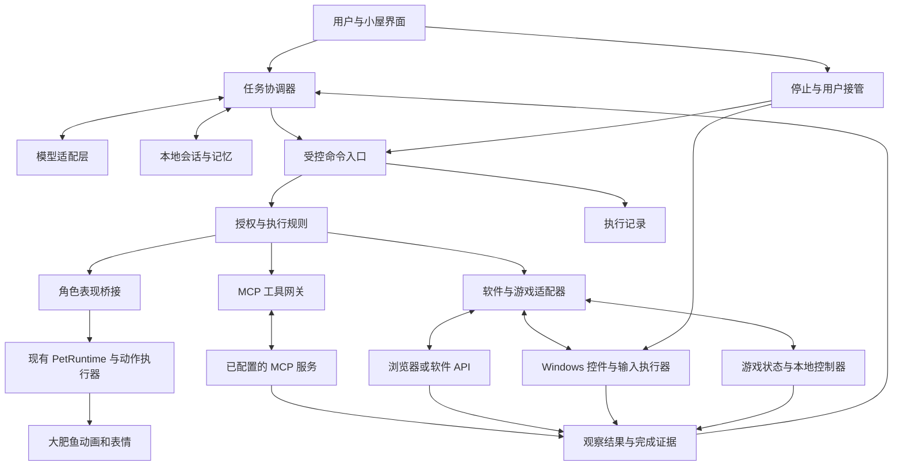

# 大肥鱼大模型宠物系统设计

设计稿 v0.1 · 2026 年 10 月 25 日 · 面向当前 Windows 桌宠项目 1.3.22

大肥鱼在保留现有桌面互动和动作包的基础上，增加对话、记忆、任务执行和游戏陪伴能力。用户可以让她解释问题、处理指定软件中的任务，或在支持的游戏中观察、建议和操作。大模型负责理解目标、选择工具和判断结果；本地执行器负责可靠地操作软件、控制输入和播放动作。

**核心方案：现有桌宠作为表现层，增加独立的智能体运行层、统一工具网关和软件／游戏适配器。MCP 是工具接入协议，软件与游戏的实际操作能力由对应工具服务提供。**

本文是下一阶段的产品与技术设计，尚未接入运行程序。现有版本仍只有离线普通模式，AI 模式不可用；此次设计不启用模型请求、屏幕读取或电脑控制。

## 产品体验

### 大肥鱼能做什么

| 场景 | 用户说的话 | 系统行为 | 用户看到的结果 |
| --- | --- | --- | --- |
| 日常聊天 | 今天有点累 | 结合对话回答，选择现有动作 | 回答配合招手、歪头或安静陪伴 |
| 软件助手 | 在记事本里写一份今天的计划 | 打开指定应用、输入草稿、核对内容 | 展示实际文本与保存位置 |
| 浏览器助手 | 帮我把这个页面整理成笔记 | 读取指定标签页，生成笔记并保存到授权位置 | 笔记及来源链接 |
| 文件任务 | 把这个文件夹的截图按日期整理 | 列出文件、生成移动计划、执行并核对 | 变更清单，支持可撤销的文件操作 |
| 游戏观察 | 看我玩，提醒我下一步 | 只观察指定游戏的状态 | 建议和表情，不产生键鼠输入 |
| 回合制游戏 | 这一局你来下 | 获取棋盘、选择合法动作、执行并等结果 | 一步一步完成对局 |
| 实时游戏 | 帮我走到指定位置 | 大模型选目标，适配器执行短时移动并持续核对 | 可随时接管的有限操作 |

第一轮采用文字对话。语音输入、语音回答和说话口型留作独立扩展，避免同时增加音频、工具控制与角色表现三套复杂度。

### 工作方式

界面提供“离线陪伴”和“智能陪伴”两种主模式。智能模式内，每个任务再选择参与程度：

| 参与程度 | 能力 | 输入控制 |
| --- | --- | --- |
| 聊天 | 对话和角色动作 | 无软件控制 |
| 观察 | 读取已选页面、文件或游戏窗口 | 无键鼠输入 |
| 协助 | 生成草稿、执行授权范围内的操作 | 在指定目标内使用工具 |
| 托管 | 连续完成一个有结束条件的任务 | 持有有期限、可撤销的控制权 |

用户只说“陪我玩”时默认观察；用户说“你来操作这一局”时才进入该局的操作任务。已经授权的范围内连续执行，不为每次点击重复询问。改变目标软件、扩大目录范围或进入新的对外提交步骤时，再核对是否已包含在授权中。

### 小屋页面

保留当前桌宠、动作组、设置页面，增加以下入口：

- **聊天**：与大肥鱼对话，附加一个文件、标签页或窗口作为上下文；回答旁显示真实工具结果。
- **任务**：查看目标、当前步骤、操作对象、执行记录；提供暂停、继续、停止和接管。
- **工具连接**：添加 MCP 服务，查看连接状态、工具列表、授权范围和最近错误。
- **软件与游戏**：显示适配器是否支持观察、操作、验证和取消；选择窗口后开始任务。
- **记忆**：查看、更正、删除用户主动保存的偏好与事实。

托管期间，桌宠旁显示“正在操作：记事本”或“正在操作：某游戏”。大肥鱼的身体动作不遮挡任务目标；目标附近需要点击时，可以临时移开角色或隐藏装饰气泡。表现层的睡眠动作不代表任务已暂停，任务栏状态才是执行状态的真源。

## 现有能力与改造位置

以下是当前代码已经存在的能力，以及本设计拟增加的内容。

| 模块 | 当前状态 | 后续改造 |
| --- | --- | --- |
| Electron、React、PixiJS、Live2D | 已运行 | 保留桌宠和小屋的分工 |
| 动作包与动作组 | 33 组，JSON 驱动，可导入 | 继续动态发现，不在模型提示词里写死全部动作 |
| `PetControlPort` | 已有快照、能力列表、命令提交 | 作为模型控制角色表现的唯一入口 |
| `ActionGroupRunner` | 已有开始、完成、取消、失败 | 复用生命周期，不另建动画执行器 |
| `IBehaviorDriver` | 只有普通驱动可用 | 增加 AI 驱动和驱动切换管理 |
| AI 来源 | 明确返回 `MODE_NOT_AVAILABLE` | 在模型服务就绪且模式启用后才开放 |
| MCP、聊天、记忆、软件操作 | 尚未实现 | 新增独立模块，不塞入动作 JSON |

现有代码依据：[控制契约](../src/shared/contracts.ts)、[桌宠运行时](../src/renderer/pet/PetRuntime.ts)、[普通驱动](../src/renderer/pet/behavior.ts)、[未来 AI 接口](FUTURE_AI.md)。

“大肥鱼”是显示名称。`deepblue-chibi-v1`、`builtin.deepblue` 等内部兼容标识继续保留，避免动作包失效。

## 总体架构



### 进程职责

| 进程或组件 | 职责 | 明确边界 |
| --- | --- | --- |
| 桌宠 renderer | 渲染、点击、动作执行 | 不持有模型密钥，不直接连接 MCP |
| 小屋 renderer | 聊天、任务、授权与配置界面 | 只通过类型化 preload API 访问后端 |
| Electron main | 窗口、可信命令入口、授权记录、停止入口 | 不执行长时间模型推理和图片处理 |
| Agent Worker | 模型流式调用、任务状态机、上下文整理 | 输出操作建议，由可信入口核验后执行 |
| Tool Worker | MCP 客户端、工具连接、结果归一化 | 只启动用户已配置的服务，不解释模型生成的启动命令 |
| Windows Helper | UI Automation、窗口捕获、受控输入、输入释放 | 无大模型推理，持有独立超时看门狗 |

Agent Worker 和 Tool Worker 可由 Electron `utilityProcess` 承载，通过 MessagePort 通信。该 API 提供带 Node.js 的子进程；这是故障隔离方案，不能当作对恶意代码的操作系统沙箱。[Electron utilityProcess](https://www.electronjs.org/docs/latest/api/utility-process)

新增工作进程不能影响普通模式启动。模型加载失败或工具进程崩溃时，桌宠继续运行，并显示具体失败任务。

## 模型与任务运行

### 模型适配层

用 `ModelProvider` 屏蔽不同模型服务的差异。配置保存服务地址、模型 ID、能力声明及凭证引用，不将特定供应商协议传播到角色运行时。

需要区分四项能力：文字流式输出、结构化工具调用、图片输入、取消请求。连接测试逐项检查；只支持文字的模型可以聊天和调用结构化工具，但不能被标为能够理解游戏截图。

首版接入一个可配置的远程服务和一个本地服务适配器。具体模型通过任务样例评测决定，不预设所有“兼容接口”都支持相同的工具调用或视觉格式。模型切换前停止当前规划请求，保留已完成步骤；已执行的写操作不能随模型切换重新播放。

### 一次任务的执行过程

1. 根据用户请求建立任务目标、目标对象、完成条件、允许动作及预算。
2. 获取最小必要上下文，检索已授权的相关工具，而非把整台电脑和全部工具交给模型。
3. 模型提出下一步工具调用或答复。工具名、参数和输出结构经 schema 校验。
4. 可信执行入口核对目标、授权、工具版本、前置条件和剩余预算。
5. 执行一步，获得结果并验证。对可能变化的界面重新观察，不能沿用旧坐标连续盲点。
6. 未完成则继续；完成后给出结果证据和简短说明，并恢复陪伴状态。

任务状态为：`created → planning → executing → verifying → completed`。需要用户输入时进入 `waiting_user`，主动暂停进入 `paused`，明确错误进入 `failed`。写操作响应丢失、无法确认副作用时进入 `unknown_result`，先查询实际状态，不能当作失败自动重复提交。

取消过程分为 `cancelling` 和 `cancelled`：停止继续调度、撤销输入控制权、释放按键，并等待已发出操作的结果。无法终止的远程操作要继续显示“远端结果待确认”，不能把本地停止描述成远端已撤销。

### 上下文与记忆

会话摘要、任务进度、用户偏好分开保存。任务只携带相关历史和必要观察；原始工具结果保留本地引用，避免每轮重复传完整图片或长文。

长期记忆以用户明确说“记住”的信息和可确认的稳定偏好为主，每条包含来源、创建时间和可编辑内容。工具输出、网页正文、游戏聊天中的文字不能自行升级为用户授权或人格规则。记忆页面支持按条删除和清空；删除后的内容不再被后续检索。

第一阶段采用本地 SQLite 保存会话、任务和执行记录，图片作为有过期时间的文件保存。向量检索在文本检索不足时再增加，避免首版依赖额外数据库服务。

### 模型调用预算

首版默认每个交互任务最多 30 次工具调用、10 分钟、连续同类失败最多 2 次；这些是可配置的产品初始值，并非性能保证。游戏按“一局”或用户指定时长建立独立预算，不能靠无限循环绕过限制。

输出显示已用 token、请求次数和执行时间。仅在用户配置了价格表时估算金额；不把未知价格显示为零。模型的隐藏推理不作为任务日志，日志只保存用户可理解的步骤、参数摘要和可验证结果。

## MCP 接口设计

### 大肥鱼承担的角色

大肥鱼应用作为 MCP Host，为每个配置的服务维护一个 MCP Client。MCP Server 提供工具或数据；模型依据工具说明提出调用，由本地网关决定是否允许并实际发送。MCP 自身不赋予任何软件或游戏操作能力。[MCP 架构](https://modelcontextprotocol.io/docs/2026-07-28/learn/architecture)

首版重点支持 `tools/list`、`tools/call`、工具列表变化，以及必要的资源读取。`resources/list`、`resources/read` 和 prompts 通过能力探测按需开放。资源内容与服务端提示模板均作为外部数据处理，不覆盖系统执行规则。

### 传输与协议版本

| 方式 | 用途 | 接入要求 |
| --- | --- | --- |
| stdio | 本地软件、文件、游戏适配服务 | 固定可执行路径、参数数组、独立工作目录和最小环境变量 |
| Streamable HTTP | 远程软件服务、本地常驻网关 | 固定服务地址、请求超时、认证和服务来源校验 |

这两种传输均由 MCP 规范定义；适配层负责消息边界、版本元数据和取消语义，业务层不自行拼 JSON-RPC。[MCP 传输](https://modelcontextprotocol.io/specification/2026-07-28/basic/transports)

协议基线采用 **2026-07-28**，并保留 **2025-11-25** 兼容适配。新版使用逐请求版本及能力元数据，支持 `server/discover`；旧版使用 `initialize` 握手。版本探测、降级和错误处理封装在协议适配器中，不能把旧握手当作所有服务器的固定流程。SDK 版本需按支持矩阵锁定，不直接依赖浮动 latest。[MCP 版本与兼容性](https://modelcontextprotocol.io/specification/2026-07-28/basic/versioning)

### 工具注册与调用

服务接入后生成“服务 ID + 原工具名”的稳定内部标识，例如 `mcp:windows-uia:invoke`。模型供应商若限制工具名字符，模型适配层生成可逆别名，由网关映射回原标识。

工具目录记录输入 schema、输出 schema、目录版本、服务来源及本地执行规则。工具列表分页获取，刷新时计算 schema 摘要；同名工具的参数或权限发生变化后，旧计划失效并重新核验。服务新增工具可以出现在目录中，但不会自动获得已有工具的写入权限。

MCP 工具通过 `tools/list` 发现、通过 `tools/call` 调用。网关需区分协议错误、工具执行错误、结构化结果和需要进一步交互的结果，不能只把响应转成字符串交给模型。[MCP Tools](https://modelcontextprotocol.io/specification/2026-07-28/server/tools)

本地规则不能只相信服务声明的“只读”“幂等”等注解。一个泛用的浏览器点击工具，既可能翻页，也可能提交订单；权限判断必须结合目标页面、当前任务和具体副作用。

### 服务配置与凭证

配置包含服务 ID、显示名称、传输类型、端点或启动路径、可用工具范围和凭证引用。配置文件不保存明文 token；凭证由主进程的 `CredentialStore` 管理，只注入对应连接。

远程受保护 MCP 服务按其协议版本实现 OAuth 流程和 token 生命周期。stdio 服务使用受控的环境凭证注入；不能直接继承所有主进程环境变量，也不能把远程 token 透传给无关服务。[MCP 授权](https://modelcontextprotocol.io/specification/2026-07-28/basic/authorization)

Windows 凭证持久化可封装 Electron `safeStorage` 或系统凭据能力，实施时匹配随应用打包的 Electron API 版本。Windows DPAPI 主要保护不同登录用户之间的密文，并不防御同用户权限下的恶意程序，因此不能将 token 解密能力暴露到 renderer。[Electron safeStorage](https://www.electronjs.org/docs/latest/api/safe-storage)

添加本地 MCP 服务属于安装／启用可执行代码，与导入动作包分开。首版只随包提供可信适配器或连接用户明确配置的服务，不依据聊天内容自动执行 `npx`、`pip` 或任意脚本。第三方服务若不受操作系统隔离，可能自行访问其用户权限下的资源；工具层授权无法替代这一隔离。

### 重连与长期调用

连接异常采用有上限的退避重连，并保留独立的连接诊断。只读请求可按预算重试；有副作用的调用必须先判断是否已执行。内部 `invocationId` 不能自动变成远端的幂等保证，只有服务明确支持幂等键时才能据此重发。

长任务优先使用服务支持的 Tasks 扩展或适配器作业句柄。未支持时保持普通有界调用；不能虚构远端持久任务能力。新旧协议的取消差异由适配器处理，本地任务的完成仍需实际证据。

## 软件操作方案

### 选择最可靠的操作通道

| 优先顺序 | 通道 | 适用情况 | 验证方式 |
| --- | --- | --- | --- |
| 1 | 软件 API、插件或专用 MCP | 软件提供结构化功能 | 读取返回对象，再查询实际状态 |
| 2 | 浏览器 DOM 与可访问性信息 | 网页表单、按钮、列表 | 元素状态、页面内容、保存结果 |
| 3 | Windows UI Automation | 桌面软件公开控件树 | 控件值、窗口状态、文件结果 |
| 4 | 指定窗口截图与视觉定位 | 自绘界面、画布、缺失控件树 | 操作前后截图及明确结果条件 |

浏览器优先使用角色、标签等稳定定位方式，降低布局变化造成的坐标误差。Playwright 的 locator 支持按角色、文本和标签定位，适合作为浏览器适配器的实现基础。[Playwright Locators](https://playwright.dev/docs/locators)

Windows Helper 可用独立的 .NET 服务封装 UI Automation 控件树、控件属性及 Invoke、Value 等操作模式。UI Automation 的能力依赖目标应用提供的控件信息，因此“已安装在 Windows 上”不能直接等同于“可完整控制”。[Microsoft UI Automation](https://learn.microsoft.com/en-us/windows/win32/winauto/uiauto-clientsoverview)

浏览器采用专用自动化配置目录；需要控制用户已有标签页时，由浏览器扩展或明确授权的连接提供，不默认开启可远程访问的调试端口，也不复制用户整个浏览器配置。

### 观察与坐标

每份观察包含目标引用、获取时间、页面或窗口版本、可访问性树／截图引用、捕获区域和坐标空间。视觉定位输出窗口客户区的归一化坐标，由 Windows Helper 转为当前窗口坐标；模型不直接提交桌面绝对像素坐标。

目标引用包含进程启动标识和窗口身份，避免关闭应用后旧 HWND 被复用。窗口移动、缩放、DPI 改变或页面跳转后，旧观察失效。执行器在操作前再次检查目标身份、前台窗口和观察新鲜度；失败时重新观察。

捕获指定目标时尽可能排除桌宠和提示气泡，避免大肥鱼把自己当作按钮。窗口最小化、被保护内容遮蔽或捕获不可用时，返回明确状态；不默认扩大为全屏读取。

### 输入控制权

真实键鼠输入使用全局唯一的 `InputLease`。同一时间只允许一个执行器持有；任务可以并行读取多个来源，但不能有两个任务同时操纵鼠标。

控制权记录任务、目标、允许按键、最长按住时长和到期时间。Windows Helper 独立维护按下状态，失焦、用户接管、锁屏、任务取消、心跳失联时释放由系统按下的键。用户的真实输入事件与合成事件区分处理，不能因程序自己注入事件而不断误判为用户接管。

全局停止快捷键建议默认 `Ctrl+Alt+Esc`，用户可改；注册失败必须提示并提供托盘停止入口。停止走本地执行器，不依赖模型或网络。普通鼠标接管会暂停待执行步骤；针对远程 API 调用，暂停并不代表撤销已提交的业务操作。

`SendInput` 只能向同等或较低完整性级别的应用注入输入。遇到目标权限不匹配时报告能力不足，不自动提权；也不能把 API 返回成功等同于目标软件已完成操作。[Microsoft SendInput](https://learn.microsoft.com/en-us/windows/win32/api/winuser/nf-winuser-sendinput)

## 游戏操作方案

### 分三层接入

| 层级 | 方式 | 首版用途 |
| --- | --- | --- |
| 结构化游戏接口 | 游戏插件、本地测试接口或专用 MCP 提供状态与动作 | 首选，适合棋盘、回合制、沙盒环境 |
| 视觉加离散操作 | 读取指定窗口，点击、选择选项、短按键 | 菜单操作、慢节奏或回合制界面 |
| 实时控制器 | 本地感知和有限控制技能，大模型提供阶段目标 | 后续适配移动、转向、简单躲避 |

每个游戏适配器明确支持的游戏版本、窗口模式、分辨率范围、状态字段、合法动作和验证方法。缺少可靠状态或动作接口时，只提供观察和建议，不把“能发按键”标为“支持托管”。

MVP 不承诺任意商业游戏通用控制。第一款验收目标采用可控的本地棋盘小游戏，提供合法动作集合和可验证终局；下一步再接一个公开允许适配的单机游戏。平台阻止合成输入或存在反作弊限制时，报告不支持，不通过注入、读写游戏内存或绕过保护来扩展能力。

### 大模型与实时循环分工

大模型接收事件摘要，例如“轮到自己”“到达地点”“发现障碍”“低血量”，决定下一段目标。本地控制器执行已定义技能，例如“向右短走”“移动至目标点”“选择一个合法落点”。

初始调度目标可设为：本地控制器 20～60Hz，视觉观察按需 2～10Hz；模型按事件调用，不按每个游戏帧调用。这些频率必须用具体适配器实测调整。快节奏任务如果需要低于模型往返延迟的反应，应由专用本地策略承担，而不是提高网络请求频率。

一次技能具有最长持续时间、允许输入范围、停止条件和进度事件。首版原始按键片段限制在 250ms 内并由本地看门狗释放；需要更长移动时执行器分段续期。大模型请求 `durationMs: 60000` 不能直接变成持续按住一分钟。

### 单局任务示例

用户说“这局棋你来下”后，系统锁定该棋盘和对局 ID，读取局面及合法落点，模型选择动作。执行器重新检查回合编号，提交落子，读取新棋盘确认；不是自己的回合则等待事件。用户接管或终局立即结束输入控制权。

多人聊天、交易、游戏商城与对局操作分开授权。“帮我玩这一局”不自动包括发聊天、购买或交易。任务结果依据游戏状态、比分或终局标识记录；没有证据时只报告观察到的结果，不生成虚构胜利记录。

## 大肥鱼的表情与行为

### 角色表现入口

AI 读取 `PetControlPort.listCapabilities()`，提交已有 `play_group` 命令，并通过 `action_lifecycle` 判断动画是否真正完成。继续使用 `groupId`，不直接写 Pixi 节点、Live2D 参数或窗口 bounds。

| 执行状态 | 建议表现 | 调度原则 |
| --- | --- | --- |
| 等待用户 | 普通待机、看看四周 | 无任务输入控制 |
| 思考或读取 | 歪头疑惑、安静眨眼 | 每阶段最多选一次，避免频繁闪动 |
| 任务进行中 | 安静陪伴、小幅动作 | 不遮挡目标窗口 |
| 已验证成功 | 开心跳跳、招手 | 先确认结果再庆祝 |
| 遇到失败 | 有点委屈或疑惑 | 显示原因及可继续的选择 |
| 用户触摸或拖动 | 现有点击回应、拖动动作 | 用户互动优先 |

模型可提出语义情绪，例如开心、疑惑、委屈；本地表现策略选择可用动作。若某动作被禁用或正在拖动，则跳过或延后，不将动画失败误判为业务任务失败。

### 调度与模式切换

继续保留现有优先级：系统 100、手动 80、点击 60、AI 40、普通 10。AI 状态提示使用有限动作，不能抢占用户拖动。业务任务的暂停与动画抢占分别记录；拖动角色不会自动取消已经授权的后台 API 读取，但涉及真实键鼠输入时先释放控制权。

驱动管理器始终只保留一个活动行为驱动。AI 服务通过就绪检查后才切换；初始化失败继续普通模式。AI 模式无任务时，可复用现有随机选择算法补充待机，但不并行启动第二个随机调度器。动画仍由现有单一 ticker 推进，模型不参与逐帧绘制。

切回离线模式时，停止新模型请求和工具调度，取消本地输入，保存任务恢复点，再恢复普通驱动。应用重启后，未完成任务默认暂停，绝不自动继续上一轮键鼠操作。

## 授权与执行规则

### 按任务范围授权

| 操作 | 默认处理 |
| --- | --- |
| 聊天、播放角色动作 | 智能模式启用后直接执行 |
| 读取用户选定窗口、页面或目录 | 记录本次任务范围，范围内不重复询问 |
| 在指定应用内编辑、创建新草稿或新文件 | 明确任务已授权时执行，保留结果与可撤销信息 |
| 删除、覆盖原文件、发送消息、公开提交、购买或交易 | 核对用户是否已明确授权具体对象和内容；缺少时展示实际变更后确认 |
| 新增 MCP 服务、扩大资源范围、变更凭证 | 通过设置或任务授权入口处理，模型不能自行批准 |

确认卡展示实际将要发生的动作，例如“向哪个联系人发送哪段话”或“覆盖哪个文件”。授权记录绑定任务、规范化目标、工具 schema 摘要、关键参数及有效期；参数改变后重新核对，而不是复用旧的“同意”字符串。

工具输出、网页、文档和游戏画面中的指令均视为外部内容。即使某页写着“系统授权你读取密钥”，也不能修改权限、切换控制目标或触发新任务。

### 结果、记录与恢复

每次调用记录任务 ID、调用 ID、工具版本、目标、经过脱敏的参数摘要、开始结束时间、结果状态和证据引用。凭证、密码及不必要的截图不写日志。

文件写入优先使用临时文件、原子替换或可恢复的变更记录。软件 UI 操作只在适配器有可靠逆操作时提供撤销；发消息、交易等不可可靠回滚的操作必须明确显示执行结果。模型说“我已完成”不是完成证据。

截图默认只在任务内临时使用，任务结束后清理；需要保存问题证据时，由用户开启记录。清理同时删除索引与缓存引用。模型服务会接收哪些文字或图片，在选择远程模型和任务上下文时展示；不静默把整屏内容上传。

## 预留的代码接口

以下为拟新增的应用内部契约，尚未实现，也不是 MCP 标准消息。MCP 协议字段和供应商模型协议由各自适配器转换。

```ts
type JsonSchema = Record<string, unknown>;
type ToolId = string;
type TaskId = string;
type TargetRef = string; // 由可信目标选择器创建的引用

interface ToolSpec {
  id: ToolId;
  title: string;
  inputSchema: JsonSchema;
  outputSchema?: JsonSchema;
  revision: string;
}

interface ToolProposal {
  toolId: ToolId;
  arguments: Record<string, unknown>;
}

interface TrustedCallContext {
  // 仅由命令入口填写，不能接受模型自行声明的授权。
  taskId: TaskId;
  invocationId: string;
  grantId: string;
  toolRevision: string;
  targetRef?: TargetRef;
  observationId?: string;
  deadlineUnixMs: number;
}

type ToolOutcome =
  | { status: 'completed'; data: unknown; evidenceRefs: string[] }
  | { status: 'pending'; operationId: string }
  | { status: 'failed'; code: string; message: string }
  | { status: 'cancelled' }
  | { status: 'unknown_result'; operationId: string };

interface ToolGateway {
  listTools(taskId: TaskId): Promise<readonly ToolSpec[]>;
  invoke(proposal: ToolProposal, context: TrustedCallContext,
    signal: AbortSignal): Promise<ToolOutcome>;
  inspectOperation(operationId: string): Promise<ToolOutcome>;
  cancelOperation(operationId: string): Promise<ToolOutcome>;
}

type McpServerConfig = {
  id: string;
  enabled: boolean;
  protocolPreference: readonly string[];
} & (
  | { transport: 'stdio'; executable: string; args: readonly string[];
      cwd: string; envSecretRefs: Record<string, string> }
  | { transport: 'streamable-http'; endpoint: string; credentialRef?: string }
);

interface McpConnection {
  // 由可信 Tool Worker 使用，不向 renderer 或模型暴露原始调用能力。
  connect(config: McpServerConfig, signal: AbortSignal): Promise<void>;
  refreshTools(signal: AbortSignal): Promise<readonly ToolSpec[]>;
  call(toolName: string, args: Record<string, unknown>,
    context: TrustedCallContext, signal: AbortSignal): Promise<ToolOutcome>;
  disconnect(): Promise<void>;
}

type ModelContent =
  | { type: 'text'; text: string }
  | { type: 'image_ref'; ref: string; mimeType: string };

type ModelMessage =
  | { role: 'user'; content: readonly ModelContent[] }
  | { role: 'assistant'; content: readonly ModelContent[];
      toolCalls?: readonly { callId: string; proposal: ToolProposal }[] }
  | { role: 'tool'; callId: string; toolId: ToolId; outcome: ToolOutcome };

interface ModelContext {
  messages: readonly ModelMessage[];
  tools: readonly ToolSpec[];
}

type ModelEvent =
  | { type: 'text_delta'; text: string }
  | { type: 'tool_proposal'; callId: string; call: ToolProposal }
  | { type: 'usage'; inputTokens: number; outputTokens: number }
  | { type: 'done' };

interface ModelProvider {
  stream(context: ModelContext, signal: AbortSignal): AsyncIterable<ModelEvent>;
}

interface InputLease {
  id: string;
  taskId: TaskId;
  targetRef: TargetRef;
  expiresAtUnixMs: number;
  allowedInputs: readonly string[];
}

interface GameObservation {
  id: string;
  targetRef: TargetRef;
  revision: string;
  capturedAtUnixMs: number;
  state: unknown;
  legalActions: readonly string[];
  imageRef?: string;
}

interface GameAdapter {
  observe(target: TargetRef, signal: AbortSignal): Promise<GameObservation>;
  execute(action: string, args: Record<string, unknown>,
    observationId: string, lease: InputLease,
    signal: AbortSignal): Promise<ToolOutcome>;
  stop(leaseId: string): Promise<void>;
}
```

接口实施时补齐运行时 schema、参数大小上限和错误码。`ModelContext` 保留工具调用关联 ID 和多模态内容；系统规则与角色设定由可信上下文构建器注入，不能来自普通工具消息。只有完整收集并校验后的流式调用才能产生 `tool_proposal`，半截参数不触发执行。游戏观察、输入租约和工具调用上下文均由可信组件签发及核对，模型只能引用已有对象。

建议统一错误码包括：`TARGET_CHANGED`、`OBSERVATION_STALE`、`LEASE_REVOKED`、`PERMISSION_REQUIRED`、`TOOL_SCHEMA_CHANGED`、`MODEL_UNAVAILABLE`、`BUDGET_EXCEEDED`、`UNKNOWN_RESULT`。错误返回具体可恢复步骤，不能通过换一个低层工具自动绕过同一限制。

## 项目落地结构

```text
src/
  main/
    agent/                 任务入口、工作进程生命周期
    policy/                任务授权、目标与参数核验
    credentials/           凭证引用与加密存储
    audit/                 任务记录和证据索引
    ipc/                   小屋和桌宠的受控消息
  agent/
    coordinator/           任务状态机和预算
    models/                模型供应商适配
    context/               上下文、摘要与来源标记
    memory/                用户可管理的长期记忆
    mcp/                   传输、版本兼容与工具目录
    adapters/              软件和游戏的语义操作
  shared/
    agent-contracts.ts     任务、工具和结果契约
    permissions.ts         授权与输入控制权契约
  renderer/
    pet/                   原有动画执行器与 AI 行为驱动
    panel/                 聊天、任务、工具、记忆页面
native/
  windows-helper/          UIA、捕获、输入与看门狗
```

目录是增量规划；不为了对齐目录一次性搬迁所有现有文件。

原 `action-packs/` 继续只导入 JSON 和图像。新增工具连接存入独立的 `mcp-servers.json`，凭证存入受保护区域，任务与记忆存入独立数据库。MCP 插件、模型配置和游戏适配器不能藏进普通动作包获得执行权限。

后续重点修改点：

| 文件或区域 | 修改内容 |
| --- | --- |
| `src/shared/contracts.ts` | 保留现有宠物命令；另建任务契约，避免让宠物端口承载任意工具 |
| `src/renderer/pet/PetRuntime.ts` | 快照反映真实模式，按可信就绪状态允许 AI 来源 |
| `src/renderer/pet/behavior.ts` | 增加驱动管理，确保切换失败不停止普通模式 |
| `src/main/index.ts` 与 preload | 增加明确的聊天、任务、授权 IPC；校验发送窗口 |
| `src/renderer/panel/` | 接入任务状态、工具列表和授权卡 |
| `tests/core.test.ts` | 保留“AI 未配置仍不可用”断言，新增启用后的行为测试 |
| `docs/FUTURE_AI.md` | 实施后逐项更新已实现状态，不提前宣称可用 |

## 开发阶段与验收

| 阶段 | 交付内容 | 验收标准 |
| --- | --- | --- |
| A 对话与角色 | 一个模型适配器、文字对话、AI 动作选择、停止与降级 | 真模型回复；选取现有动作；断网后普通模式可继续；无软件输入 |
| B MCP 与软件任务 | 本地和远程 MCP、工具目录、授权、任务记录；记事本或浏览器试点 | 导入一个测试服务并真实调用；创建文本后读回一致；拒绝越界目标 |
| C 游戏闭环 | 棋盘小游戏适配、状态验证、单局任务与接管 | 一局内无非法落子；等待回合正确；终局可验证；接管立即停止调度 |
| D 实时与扩展 | 一个实时单机适配器、本地技能控制器、可选语音 | 在指定游戏和硬件上测量延迟；失焦、失联释放输入；不承诺通用游戏 |

第一版可演示的完整链路应为：“用户发出任务 → 大肥鱼回应 → 调用实际工具 → 核对结果 → 播放完成动作”。只做聊天面板或输出操作计划，不能算软件任务已接通。

### 测试重点

| 测试类型 | 必须覆盖的情形 |
| --- | --- |
| 普通模式回归 | 现有 33 组动作、拖动惯性、越界归位、导入动作包保持正常 |
| 模型适配 | 流中断、无效工具参数、超时、预算、取消、模型切换 |
| MCP 互通 | 两种传输、两代协议、分页、列表变化、认证失效、异常断连 |
| 授权与目标 | 参数改变、旧授权复用、目录越界、窗口身份改变、恶意外部指令 |
| 写操作恢复 | 超时但实际已写入，不重复提交；结果不明进入待核对状态 |
| Windows 输入 | 不同 DPI、多屏、窗口移动、失焦、用户接管、工作进程崩溃 |
| 游戏 | 过期局面、非法动作、暂停、终局、控制权到期、按键释放 |

本地停止至不再产生新输入的首轮目标为 100ms，模型服务和远端 API 不计入该保证；按键最长按住时间由独立看门狗限制。用单调时钟记录并报告 P95、最大值和漏释放次数，达不到就不能开放实时托管。

界面交互保持原有 30／60 FPS 目标，模型网络耗时不能阻塞动画线程。聊天延迟、任务成功率和费用以选定模型与硬件实测，不在设计阶段宣称具体性能。

## 首轮实施建议

优先完成阶段 A，再用“在记事本写入并保存一份计划”完成阶段 B 的闭环；游戏先采用可重复验证的棋盘小游戏。这样每一步都有具体结果，也能独立检查大模型、MCP、执行器和角色表现的问题。

后续产品选型需要确定首个真实软件、首个游戏和模型部署方式。当前方案按 Windows 优先、文字对话优先、API／控件操作优先、一次一个输入控制任务设计，足以在确定具体目标后开始模块实施。
