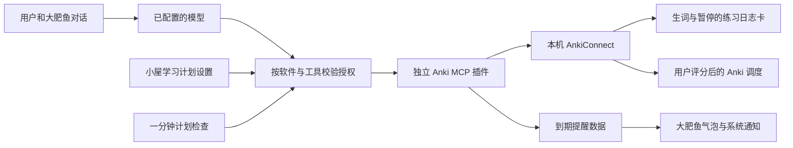

# Anki 日语陪练与学习计划

Anki 日语插件以 1.1.0 独立发布，适配当前大肥鱼 1.5.0。完整安装、对话、记录、复习和提醒说明在 [插件说明](../README.md)，也随独立 ZIP 分发。插件版本、MCP 握手和 ZIP 名称统一读取插件自身清单，不驱动主程序版本更新。

源码：`plugins/anki-japanese/`。应用携带插件目录，小屋可选择安装，不自动执行或授权。`npm run pack:anki` 生成 `release/DaFeiYu-Anki-Japanese-1.1.0.zip`。无额外 npm 包依赖，使用 Electron 自带 Node 子进程。

## 设计

宿主没有硬编码 Anki 工具名。清单声明设置字段、读写工具和提醒工具；设置页、桌面聊天、后台提醒走同一签名授权检查。提醒额外要求用户开启，默认关闭。停止与撤权不靠模型执行。

`anki_launch` 单独授权，启动位置只取宿主注入的 `DAFEIYU_SOFTWARE_DIRECTORY`。定位 `Anki.exe` / `app/Anki.exe` 并校验真实路径；若存在有效的 `data/prefs21.db`，使用 `-b` 指定现有数据，计划已绑定用户时通过 `-p` 指定。无任意路径/命令参数、不经过 shell。启动前检查接口，启动后有界轮询，只在 API v6 和当前用户均返回时报告已连接；并发共用一次启动，30 秒内不重复发起。取消只终止等待，不关闭 Anki。

写入前核对绑定 profile。笔记通过 key 字段和标签去重；失败轮次固定原内容后恢复。复习先保存 token，揭示答案后才允许评分，提交前消耗 token，未知结果不重试。插件不直接打开数据库、不修改现有牌组配置或主动同步。

使用 API v6 的 `version/getActiveProfile/deckNames/findCards/cardsInfo/modelNames/modelFieldNames/createModel/createDeck/findNotes/addNote/suspend/answerCards`。依据：[AnkiConnect 官方仓库](https://git.sr.ht/~foosoft/anki-connect) 和本机已安装插件的 v6 源码。旧 [GitHub 官方入口](https://github.com/FooSoft/anki-connect) 已注明迁移。

## 验收边界

逻辑测试覆盖离线、错误用户、HTML 转义、去重和部分失败恢复、复习阶段、重复评分阻止、过期凭据、提醒日期/目标达成及状态损坏。宿主测试覆盖设置授权、提醒显式开关、暂停、重启去重和签名变更撤权。

基础 GUI 验证使用真实 Windows 窗口和 MCP 子进程，Anki/模型后端为隔离夹具。后续按用户要求，在独立真实 Anki 集合中完成20词、43次评分的流程评估；未向用户原有学习集合写入测试卡片或评分。真实模型因 HTTP 401 未完成验证，后续流程使用脚本驱动。

评估已确认取卡绕过原生队列、复习耗时为0、计划统计不包含正式背词进度等问题，当前不能将基础测试通过视为日常复习验收通过。详见 [20词评估与修复顺序](USER_AUDIT.md)。仓库整体测试记录位于项目根目录的 `docs/TEST_REPORT.md`。
